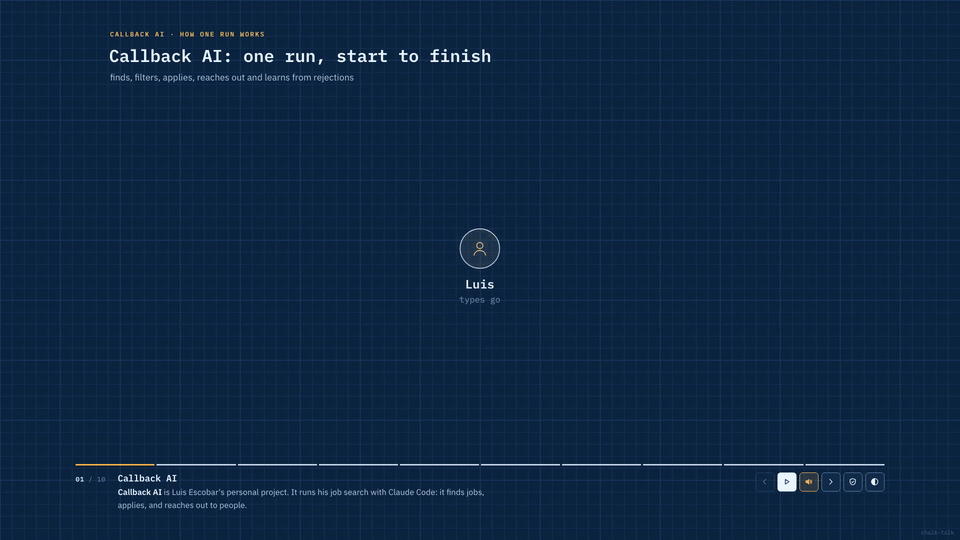
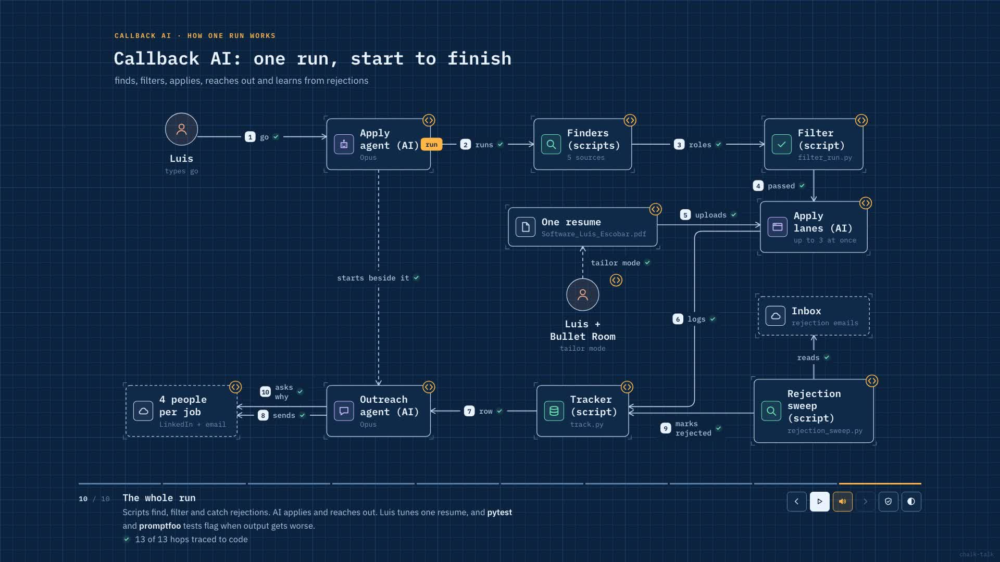

# Callback AI

*Automated job search, application, and outreach with Claude Code*

Personal project by [Luis Escobar](https://github.com/Escobar-Luis) · March 2026 to present

 

**[Watch the 110-second walkthrough](media/callback-ai-walkthrough.mp4)**

 

## What I built

- Built an internal agent with custom Claude Code skills and Python scripts that finds, filters, and applies to jobs, with pytest and promptfoo regression tests that flag when its output gets worse
- Wired the agent's tools and workflows: Gmail through MCP, my browser sessions through OpenCLI, and apply and outreach running in parallel on separate Chrome profiles, with outreach rules I wrote
- Automated how I learn design: a book-consult skill finds the O'Reilly chapter for my blocker and asks it for the fix, and a voiced chalk-talk diagram shows the architecture my agents built

## Architecture

  

## About this repo

The source is private. This page is the public write-up of what Callback AI does. Happy to walk an interviewer through the code live.

 

[Portfolio](https://luisalfredoescobar.netlify.app/) · [LinkedIn](https://www.linkedin.com/in/luisalfredoescobar/) · [X](https://x.com/luisalfescobar) · [GitHub](https://github.com/Escobar-Luis)

